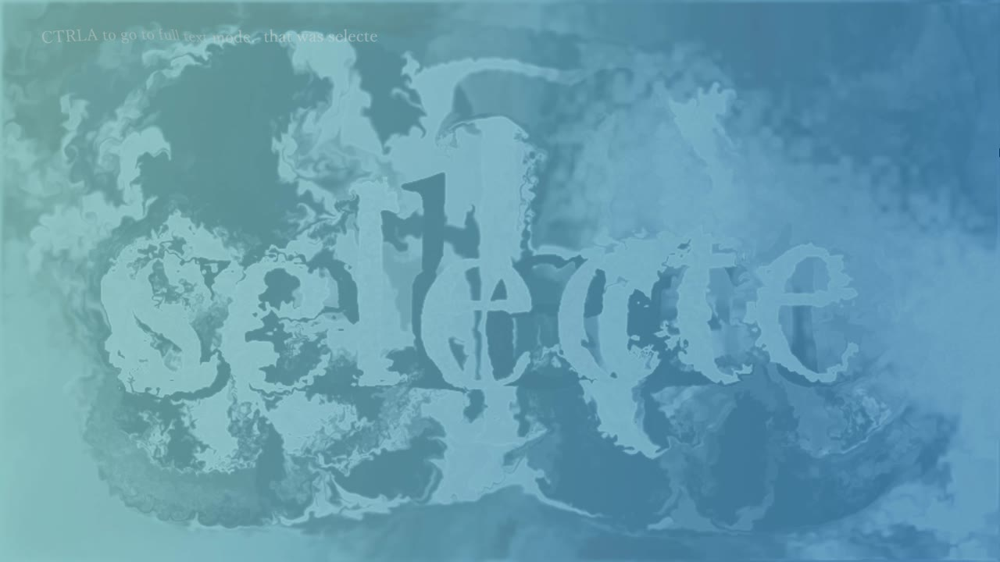

# WordCraft

An immersive native Windows writing and reading app. Typed words stir procedural smoke; reading brings the draft into a kinetic line. The full-text editor places editable, woven letters on a simulated cloth surface.

**Controls: press F1 to toggle the keycap overlay, or read the [complete controls sheet](CONTROLS.txt).**

## Demo

[](https://youtu.be/Bp3ybJkoUTM)

[Watch the demo on YouTube](https://youtu.be/Bp3ybJkoUTM).

## Run

Download `WordCraft-2.3.1-windows-x64.zip` from [Releases](https://github.com/dmitryalexander/word-craft/releases), extract the entire ZIP to a writable folder, then open `Open WordCraft.cmd` or `Bleeding-Edge/App/WordCraft.exe`. Keep the folder layout intact. No installer, account, Python, model download or chat connection is required.

Windows 10/11 x64, .NET Framework 4.8 and a Direct3D 11 GPU with Shader Model 5 support are required. Windows fonts are used; unavailable families fall back to installed fonts. The executable is unsigned. Settings are saved beside the app under `Bleeding-Edge`; use a writable folder rather than Program Files.

**Drafts exist only for the current session. Copy text elsewhere before closing or clearing.** WordCraft currently has no document Open/Save workflow or automatic draft recovery. Ctrl+S is not a document save command.

## Controls

| Control | Action |
| --- | --- |
| Mouse wheel | Scale the centered simulation from 25% to 100%, with rounded corners over black |
| Ctrl+wheel in full text | Enlarge/shrink only the font on the cloth mesh |
| Type | Write into the smoke view |
| Enter / Ctrl+Enter | Read from the start |
| Shift+Enter | Insert a new line |
| Ctrl+V | Paste text and start reading |
| Tab | Switch typing/reading |
| Ctrl+Tab | Open reading paused |
| Space while reading | Pause/play |
| Ctrl+Shift+Space | Replay from the start |
| Hold Shift | Read at one third speed |
| Shift+left drag | Scrub through the text |
| Ctrl+left drag vertically | Adjust master volume |
| Click a reading word | Edit at that word |
| Ctrl+A | Open full-text editing and select all |
| Alt+A | Return to smoke typing |
| Caps Lock | Graphics quality, audio, colors and text-motion options |
| Ctrl+N | Clear the session draft |
| Backtick / tilde | Toggle fullscreen |
| Esc | Cancel gesture, close options, or close app |
| F1 | Toggle the fading keycap controls overlay |

Full-text editing retains native selection, Unicode, copy/paste and undo. In Text motion options, Pause cloth freezes motion; Wind 0 removes forcing but inertia/gravity may continue. Colors, audio and cloth settings are independent of other Craft apps.

## Build and verify

Install Visual Studio 2022 C++ Build Tools (Desktop development with C++) and Windows 10/11 SDK including `fxc.exe`. Windows PowerShell 5.1 and the .NET Framework compiler are used; no NuGet dependencies are required.

```powershell
powershell -NoProfile -ExecutionPolicy Bypass -File .\Build.ps1
powershell -NoProfile -STA -ExecutionPolicy Bypass -File .\Test.ps1
powershell -NoProfile -ExecutionPolicy Bypass -File .\Package.ps1
```

Build from a clean checkout. Builds refuse to replace existing EXE/DLL outputs; preserve them before rebuilding. Test scripts create offscreen windows with audio disabled, exercise the actual GPU, and retain synthetic captures under `Bleeding-Edge/Validation`. They require a Windows graphics session. Desktop motion, listening and performance on other hardware remain manual checks.

All required C#, C++, shader, icon and PCM sources are included here. No sibling workspace folders are needed. Shared implementation type names remain for compatibility; no Codex/ChatCraft client is compiled. Narration support is dormant and has no bundled TTS engine/models.

## Release

See [release notes](RELEASE-NOTES.md), [credits](THIRD-PARTY-NOTICES.md) and [release checklist](RELEASING.md). The workflow builds and uploads a portable artifact on pull requests/manual runs. Pushing a `v*` tag builds a **draft** GitHub release for review.

WordCraft is open source under the [MIT License](LICENSE). Copyright (c) 2026 dmitryalexander. The modem audio retains its CC0 dedication; see [credits](THIRD-PARTY-NOTICES.md).
